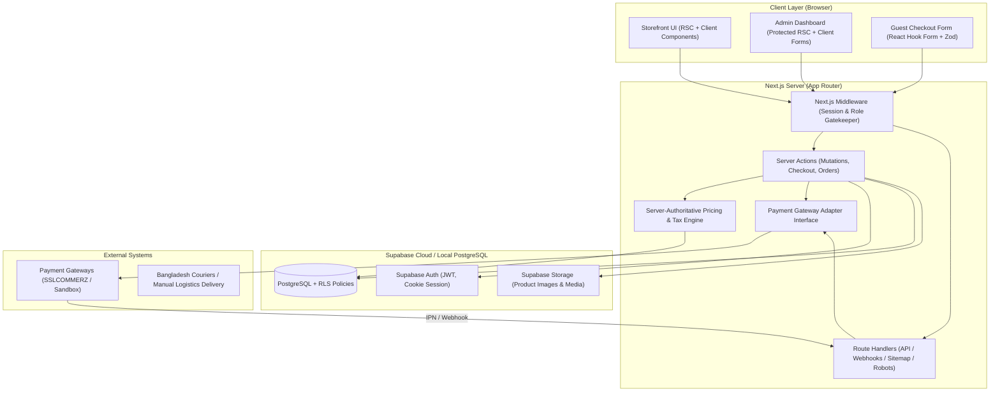

# System Architecture & Code Organization

## 1. High-Level Architecture Overview
The platform leverages a modern, decoupled full-stack architecture built on Next.js App Router (React Server Components) and Supabase (PostgreSQL with Row Level Security, Auth, and Object Storage).



---

## 2. Source Code Organization
The application adheres strictly to a feature-sliced, modular architecture:

```
src/
├── app/
│   ├── (storefront)/                  # Public customer storefront layout & routes
│   │   ├── page.tsx                   # Dynamic homepage (hero banners, categories, collections)
│   │   ├── products/                  # Catalog browsing & faceted search
│   │   │   ├── page.tsx               # Product listing with filters
│   │   │   └── [slug]/page.tsx        # Product detail page (PDP)
│   │   ├── categories/                # Category landing & hierarchy
│   │   │   └── [slug]/page.tsx
│   │   ├── cart/page.tsx              # Shopping cart view
│   │   ├── checkout/page.tsx          # Guest & authenticated checkout
│   │   ├── order-confirmation/[ref]/  # Post-purchase receipt & summary
│   │   ├── track-order/page.tsx       # Public/Guest order status tracking by token
│   │   ├── about/page.tsx             # Informational pages
│   │   ├── contact/page.tsx
│   │   ├── faq/page.tsx
│   │   ├── privacy-policy/page.tsx
│   │   └── terms-and-conditions/page.tsx
│   ├── (auth)/                        # Authentication routes
│   │   ├── login/page.tsx
│   │   ├── register/page.tsx
│   │   ├── forgot-password/page.tsx
│   │   └── reset-password/page.tsx
│   ├── account/                       # Customer self-service portal (protected)
│   │   ├── layout.tsx
│   │   ├── page.tsx                   # Account overview
│   │   ├── orders/                    # Order history & live status
│   │   │   └── [id]/page.tsx
│   │   ├── addresses/page.tsx         # Saved Bangladesh address book
│   │   └── profile/page.tsx           # Profile info & password update
│   ├── admin/                         # Admin Operations Dashboard (protected, role: ADMIN)
│   │   ├── layout.tsx                 # Admin sidebar, header, role check
│   │   ├── page.tsx                   # Analytics, financial metrics & KPI dashboard
│   │   ├── products/                  # Product catalog CRUD, variant editor, image manager
│   │   ├── categories/                # Category hierarchy management
│   │   ├── brands/                    # Brand registry management
│   │   ├── orders/                    # Order fulfillment, shipment assignment, COD tracking
│   │   ├── inventory/                 # Stock monitoring, restocking & movements log
│   │   ├── coupons/                   # Coupon & discount creation
│   │   ├── promotions/                # Hero banners & homepage section manager
│   │   ├── reviews/                   # Review moderation & approval queue
│   │   ├── customers/                 # Customer directory & order stats
│   │   ├── shipping/                  # Zone, division & fee rule manager
│   │   ├── settings/                  # Store info, tax rules & gateway credentials
│   │   └── audit-logs/page.tsx        # System audit trail
│   ├── api/                           # Route handlers
│   │   ├── webhooks/payment/          # Idempotent gateway IPN handlers
│   │   └── revalidate/                # On-demand ISR cache revalidation
│   ├── sitemap.ts                     # Dynamic XML sitemap generator
│   ├── robots.ts                      # Dynamic robots.txt
│   └── layout.tsx                     # Root HTML, fonts, theme provider, global toast
├── components/
│   ├── ui/                            # Atomic design tokens & shadcn/ui components
│   ├── storefront/                    # Header, announcement bar, navigation, footer
│   ├── product/                       # ProductCard, Gallery, VariantSelector, PriceDisplay
│   ├── cart/                          # CartDrawer, CartTable, CartItemRow, OrderSummary
│   ├── checkout/                      # BangladeshAddressForm, PaymentMethodSelector
│   └── admin/                         # DataTable, MetricsCard, StatusBadge, ImageUploader
├── features/                          # Business logic encapsulated by domain
│   ├── auth/                          # Supabase auth hooks, server session getters
│   ├── products/                      # Product queries, mutations, variant handlers
│   ├── categories/                    # Category trees & navigation builders
│   ├── inventory/                     # Stock reservation & concurrency decrement
│   ├── cart/                          # Cart state, local-to-remote merge handlers
│   ├── checkout/                      # Order creation transaction & validation
│   ├── orders/                        # Order state machine transitions, audit logging
│   ├── payments/                      # Payment provider interface & adapters
│   ├── shipping/                      # Bangladesh division/district data & rate calculator
│   └── reviews/                       # Review submission & moderation
├── lib/
│   ├── supabase/
│   │   ├── client.ts                  # Browser Supabase client (createBrowserClient)
│   │   ├── server.ts                  # Server RSC/Action client (createServerClient with cookies)
│   │   ├── admin.ts                   # Service-role client (strict server-side only for webhooks/admin)
│   │   └── middleware.ts              # Session refresher for Next.js middleware
│   ├── validation/                    # Zod schemas for checkout, products, coupons
│   ├── pricing/                       # Integer-safe currency calculator
│   ├── seo/                           # Metadata & JSON-LD schema generators
│   └── utils.ts                       # Formatters (currency, Bangladesh phone, dates)
├── types/                             # TypeScript definitions & Supabase generated DB types
└── docs/                              # Architecture, design & operational documentation
```

---

## 3. Data Flow & Security Principles
1. **Server-Authoritative Business Logic**: The browser never dictates line totals, tax calculations, discounts, shipping fees, or inventory availability. All totals are re-calculated on the server during order creation.
2. **Double-Layered Security**:
   * **Application Layer**: Next.js Server Actions validate all inputs via strict Zod schemas and check user permissions before any mutation.
   * **Database Layer**: Supabase Row Level Security (RLS) ensures that even if an unauthorized request reaches PostgreSQL, it is blocked at the database engine level.
3. **Session & Auth Management**: Next.js server cookies managed via `@supabase/ssr` ensure zero credential leakage to client bundles, with automated token refreshing in middleware.
