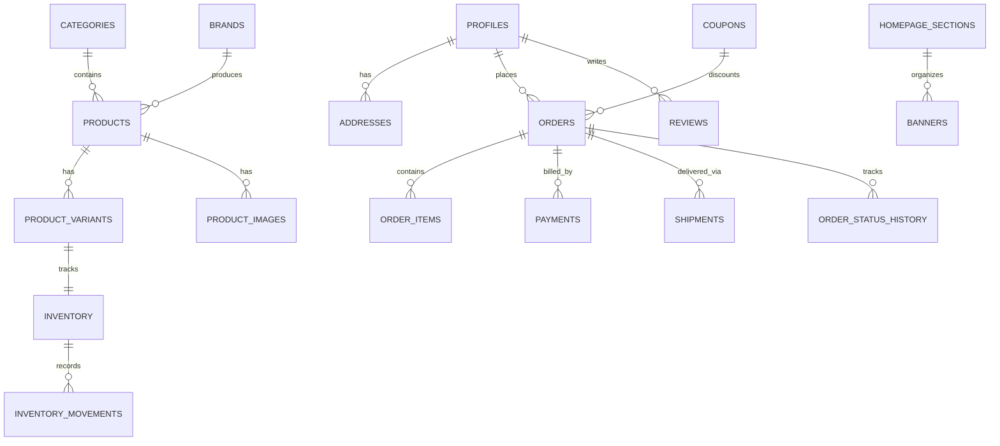

# Database Design & Schema Specification

## 1. Relational Entity Overview
The database is built on Supabase PostgreSQL with strict foreign keys, check constraints, immutable snapshots, and Row Level Security (RLS).

---

## 2. Core Entities & Tables

### 2.1 Profiles & Access Control
* `profiles`:
  * `id`: UUID (Primary Key, references `auth.users.id` ON DELETE CASCADE)
  * `email`: TEXT NOT NULL UNIQUE
  * `full_name`: TEXT
  * `phone`: TEXT
  * `role`: TEXT NOT NULL DEFAULT 'CUSTOMER' CHECK (role IN ('CUSTOMER', 'ADMIN', 'ORDER_MANAGER', 'INVENTORY_MANAGER'))
  * `created_at`, `updated_at`: TIMESTAMPTZ NOT NULL DEFAULT NOW()

### 2.2 Addresses
* `addresses`:
  * `id`: UUID (Primary Key)
  * `user_id`: UUID (Nullable, references `profiles.id`)
  * `recipient_name`: TEXT NOT NULL
  * `phone`: TEXT NOT NULL
  * `division`: TEXT NOT NULL
  * `district`: TEXT NOT NULL
  * `upazila`: TEXT NOT NULL
  * `address_line`: TEXT NOT NULL
  * `delivery_instructions`: TEXT
  * `is_default`: BOOLEAN DEFAULT FALSE
  * `created_at`: TIMESTAMPTZ NOT NULL DEFAULT NOW()

### 2.3 Catalog (Categories, Brands, Products, Variants)
* `categories`:
  * `id`: UUID (PK)
  * `parent_id`: UUID (Self-reference for multi-level hierarchies)
  * `name`: TEXT NOT NULL
  * `slug`: TEXT NOT NULL UNIQUE
  * `description`: TEXT
  * `image_url`: TEXT
  * `display_order`: INTEGER DEFAULT 0
  * `is_active`: BOOLEAN DEFAULT TRUE
  * `created_at`: TIMESTAMPTZ DEFAULT NOW()
* `brands`:
  * `id`: UUID (PK)
  * `name`: TEXT NOT NULL
  * `slug`: TEXT NOT NULL UNIQUE
  * `logo_url`: TEXT
  * `is_active`: BOOLEAN DEFAULT TRUE
* `products`:
  * `id`: UUID (PK)
  * `category_id`: UUID (FK to `categories.id`)
  * `brand_id`: UUID (FK to `brands.id`)
  * `name`: TEXT NOT NULL
  * `slug`: TEXT NOT NULL UNIQUE
  * `description`: TEXT NOT NULL
  * `specifications`: JSONB DEFAULT '{}'::jsonb
  * `is_published`: BOOLEAN DEFAULT FALSE
  * `is_featured`: BOOLEAN DEFAULT FALSE
  * `is_bestseller`: BOOLEAN DEFAULT FALSE
  * `base_price`: INTEGER NOT NULL CHECK (base_price >= 0) -- Stored in BDT Poisha (minor unit) or exact integer BDT
  * `sale_price`: INTEGER CHECK (sale_price IS NULL OR sale_price < base_price)
  * `seo_title`: TEXT
  * `seo_description`: TEXT
  * `created_at`, `updated_at`: TIMESTAMPTZ DEFAULT NOW()
* `product_variants`:
  * `id`: UUID (PK)
  * `product_id`: UUID NOT NULL (FK to `products.id` ON DELETE CASCADE)
  * `sku`: TEXT NOT NULL UNIQUE
  * `name`: TEXT NOT NULL -- e.g. "Crimson / XL"
  * `attributes`: JSONB NOT NULL DEFAULT '{}'::jsonb -- { "color": "Crimson", "size": "XL" }
  * `price_override`: INTEGER CHECK (price_override IS NULL OR price_override >= 0)
  * `sale_price_override`: INTEGER
  * `is_active`: BOOLEAN DEFAULT TRUE
  * `created_at`: TIMESTAMPTZ DEFAULT NOW()
* `product_images`:
  * `id`: UUID (PK)
  * `product_id`: UUID NOT NULL (FK to `products.id` ON DELETE CASCADE)
  * `url`: TEXT NOT NULL
  * `alt_text`: TEXT
  * `display_order`: INTEGER DEFAULT 0
  * `is_primary`: BOOLEAN DEFAULT FALSE

### 2.4 Inventory & Movements
* `inventory`:
  * `id`: UUID (PK)
  * `variant_id`: UUID NOT NULL UNIQUE (FK to `product_variants.id` ON DELETE CASCADE)
  * `quantity`: INTEGER NOT NULL DEFAULT 0 CHECK (quantity >= 0)
  * `reserved_quantity`: INTEGER NOT NULL DEFAULT 0 CHECK (reserved_quantity >= 0)
  * `safety_stock`: INTEGER DEFAULT 5
  * `updated_at`: TIMESTAMPTZ DEFAULT NOW()
* `inventory_movements`:
  * `id`: UUID (PK)
  * `variant_id`: UUID NOT NULL (FK to `product_variants.id`)
  * `change_amount`: INTEGER NOT NULL -- positive for restock, negative for sale
  * `reason`: TEXT NOT NULL -- 'PURCHASE', 'MANUAL_ADJUSTMENT', 'RETURN', 'CANCELLED_RESERVATION'
  * `reference_id`: TEXT -- Order ID or Restock ID
  * `actor_id`: UUID (FK to `profiles.id`)
  * `created_at`: TIMESTAMPTZ DEFAULT NOW()

### 2.5 Orders & Immutable Financial Snapshots
* `orders`:
  * `id`: UUID (PK)
  * `order_number`: TEXT NOT NULL UNIQUE -- e.g., "BD-20261026-9481"
  * `tracking_token`: TEXT NOT NULL UNIQUE -- High-entropy NanoID/UUID for secure guest lookup
  * `user_id`: UUID (Nullable, FK to `profiles.id`)
  * `customer_email`: TEXT
  * `customer_phone`: TEXT NOT NULL
  * `status`: TEXT NOT NULL DEFAULT 'PENDING_CONFIRMATION'
  * `payment_status`: TEXT NOT NULL DEFAULT 'UNPAID'
  * `payment_method`: TEXT NOT NULL -- 'COD', 'SSLCOMMERZ', 'BKASH', 'NAGAD'
  * `shipping_address`: JSONB NOT NULL -- Full immutable snapshot of recipient, phone, division, district, thana, address
  * `currency`: TEXT NOT NULL DEFAULT 'BDT'
  * `subtotal`: INTEGER NOT NULL CHECK (subtotal >= 0)
  * `discount_amount`: INTEGER NOT NULL DEFAULT 0
  * `shipping_fee`: INTEGER NOT NULL CHECK (shipping_fee >= 0)
  * `tax_amount`: INTEGER NOT NULL DEFAULT 0
  * `total_amount`: INTEGER NOT NULL CHECK (total_amount >= 0)
  * `coupon_code`: TEXT
  * `customer_notes`: TEXT
  * `admin_notes`: TEXT
  * `created_at`, `updated_at`: TIMESTAMPTZ DEFAULT NOW()
* `order_items`:
  * `id`: UUID (PK)
  * `order_id`: UUID NOT NULL (FK to `orders.id` ON DELETE CASCADE)
  * `product_id`: UUID NOT NULL
  * `variant_id`: UUID NOT NULL
  * `product_name`: TEXT NOT NULL -- Snapshot
  * `variant_name`: TEXT NOT NULL -- Snapshot
  * `sku`: TEXT NOT NULL -- Snapshot
  * `unit_price`: INTEGER NOT NULL CHECK (unit_price >= 0) -- Snapshot
  * `quantity`: INTEGER NOT NULL CHECK (quantity > 0)
  * `total_price`: INTEGER NOT NULL CHECK (total_price >= 0)
  * `image_url`: TEXT

### 2.6 Payments & Shipments
* `payments`:
  * `id`: UUID (PK)
  * `order_id`: UUID NOT NULL (FK to `orders.id`)
  * `provider`: TEXT NOT NULL -- 'COD', 'SSLCOMMERZ', 'BKASH'
  * `transaction_id`: TEXT UNIQUE
  * `amount`: INTEGER NOT NULL
  * `currency`: TEXT DEFAULT 'BDT'
  * `status`: TEXT NOT NULL -- 'PENDING', 'SUCCESS', 'FAILED', 'CANCELLED', 'REFUNDED'
  * `provider_response`: JSONB DEFAULT '{}'::jsonb
  * `created_at`, `updated_at`: TIMESTAMPTZ DEFAULT NOW()
* `shipments`:
  * `id`: UUID (PK)
  * `order_id`: UUID NOT NULL (FK to `orders.id`)
  * `courier_name`: TEXT NOT NULL -- 'INTERNAL_RIDER', 'STEADFAST', 'PATHAO', 'REDX'
  * `tracking_code`: TEXT
  * `dispatched_at`: TIMESTAMPTZ
  * `delivered_at`: TIMESTAMPTZ
  * `delivery_notes`: TEXT
  * `cod_collected_amount`: INTEGER DEFAULT 0
  * `cod_collected_at`: TIMESTAMPTZ

### 2.7 Order Status History & Audit Logs
* `order_status_history`:
  * `id`: UUID (PK)
  * `order_id`: UUID NOT NULL (FK to `orders.id` ON DELETE CASCADE)
  * `from_status`: TEXT NOT NULL
  * `to_status`: TEXT NOT NULL
  * `actor_id`: UUID (FK to `profiles.id`)
  * `actor_role`: TEXT NOT NULL
  * `notes`: TEXT
  * `created_at`: TIMESTAMPTZ DEFAULT NOW()
* `audit_logs`:
  * `id`: UUID (PK)
  * `action`: TEXT NOT NULL -- 'PRODUCT_UPDATE', 'PRICE_CHANGE', 'ORDER_OVERRIDE'
  * `entity_type`: TEXT NOT NULL
  * `entity_id`: TEXT NOT NULL
  * `actor_id`: UUID (FK to `profiles.id`)
  * `changes`: JSONB NOT NULL
  * `created_at`: TIMESTAMPTZ DEFAULT NOW()

---

## 3. Database Functions & Concurrency Rules
1. **Atomic Stock Decrement**: Handled through a PostgreSQL PL/pgSQL transaction `reserve_order_stock()` to eliminate race conditions and double-spending of inventory.
2. **Strict RLS Policies**:
   * Public can `SELECT` from `products`, `categories`, `brands`, and `product_variants` only where `is_published = true`.
   * Customers can `SELECT` their own `orders` and `profiles`.
   * Admins have full access enforced via `profiles.role = 'ADMIN'`.
   * Guest order lookup is restricted to exact match of `tracking_token` + `phone`.
