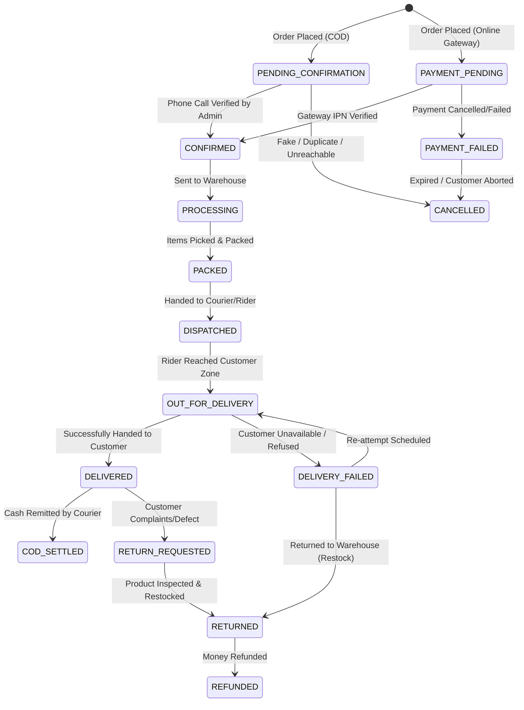

# Order Lifecycle & State Machine Specification

## 1. Lifecycle Overview
In the Bangladesh e-commerce context, where over 70% of transactions are Cash on Delivery (COD), order management must clearly separate **fulfillment state** from **payment settlement state**. An order marked as "Delivered" does not imply payment is received until the courier or delivery rider remits the collected cash.

---

## 2. Supported Order States
| Order Status | Description | Permitted Next States |
| :--- | :--- | :--- |
| `PENDING_CONFIRMATION` | Default initial state for COD orders. Awaiting customer contact validation. | `CONFIRMED`, `CANCELLED`, `ON_HOLD` |
| `PAYMENT_PENDING` | Initial state for digital gateway checkout. Awaiting webhook verification. | `CONFIRMED`, `PAYMENT_FAILED`, `CANCELLED` |
| `CONFIRMED` | Order verified and authorized for fulfillment. | `PROCESSING`, `CANCELLED`, `ON_HOLD` |
| `PROCESSING` | Order routing to warehouse team for item gathering. | `PACKED`, `ON_HOLD`, `CANCELLED` |
| `PACKED` | Items packaged, shipping label generated, awaiting courier handover. | `DISPATCHED`, `CANCELLED` |
| `DISPATCHED` | Parcel handed over to logistics provider (internal rider or courier). | `OUT_FOR_DELIVERY`, `DELIVERY_FAILED` |
| `OUT_FOR_DELIVERY` | Rider actively attempting delivery to recipient address. | `DELIVERED`, `DELIVERY_FAILED` |
| `DELIVERED` | Parcel delivered to customer. | `RETURN_REQUESTED`, `COMPLETED` |
| `DELIVERY_FAILED` | Customer could not be reached or delivery attempt failed. | `OUT_FOR_DELIVERY` (Retry), `RETURNED` |
| `RETURN_REQUESTED` | Customer filed a return/exchange request within policy window. | `RETURNED`, `DELIVERED` (Rejected return) |
| `RETURNED` | Parcel returned to warehouse and inventory safely restocked. | `REFUND_PENDING`, `REFUNDED`, `COMPLETED` |
| `CANCELLED` | Order cancelled before dispatch. Reserved inventory is unlocked. | Final State |
| `ON_HOLD` | Suspicious activity, stock discrepancy, or customer requested hold. | `CONFIRMED`, `CANCELLED` |

---

## 3. Payment Status States
Maintained independently from Order Status:
1. `UNPAID` (Default for COD)
2. `PENDING` (Payment session initiated with gateway)
3. `AUTHORIZED` (Funds held)
4. `PAID` (Confirmed via verified gateway webhook or admin cash settlement)
5. `FAILED` (Gateway transaction unsuccessful)
6. `REFUNDED` (Funds returned to customer)

---

## 4. State Transition Rules & Safeguards
1. **COD Remittance Separation**:
   * When an order transitions to `DELIVERED`, if `payment_method = 'COD'`, `payment_status` remains `UNPAID`.
   * Only when the admin/accounts team marks `RECORD_COD_COLLECTION` does `payment_status` transition to `PAID`.
2. **Inventory Safety**:
   * When transitioning to `CANCELLED` or `RETURNED`, inventory is automatically credited back via an `inventory_movement` record.
3. **Mandatory Audit Log**: Every transition triggers a row write to `order_status_history` detailing:
   * Previous State
   * New State
   * Actor ID (Admin UUID or System Webhook)
   * Actor Role
   * Transition Reason / Notes
